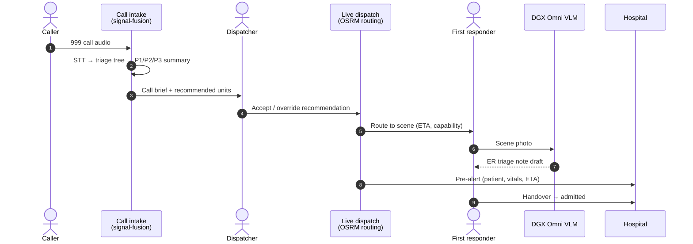
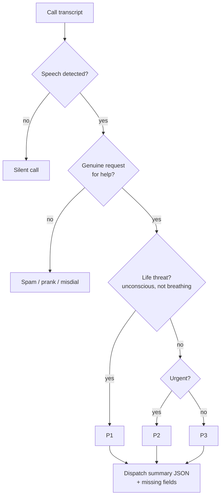
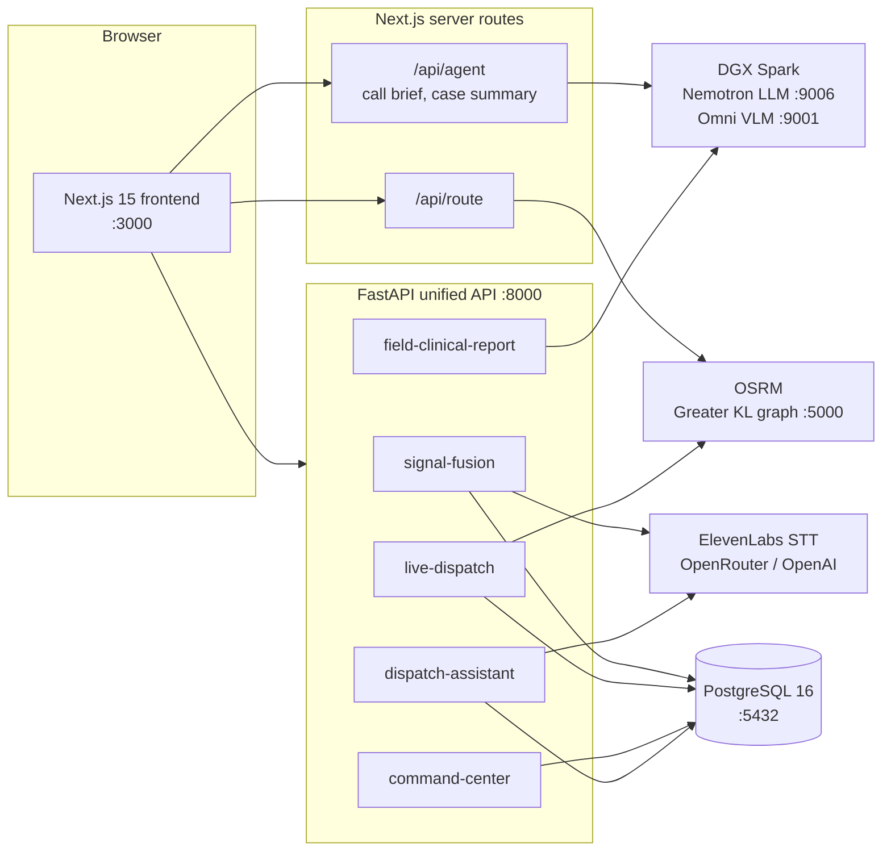
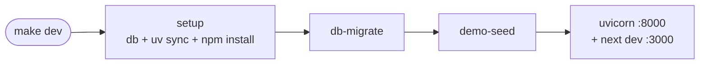

# Aegis999 — Golden Minute Emergency Response

Repository for the **ACE Malaysia 2026: Gigabyte x Nvidia DGX Spark Hackathon**.

Aegis999 is an AI decision-support platform for ambulance dispatch in Greater Kuala Lumpur. It takes a 999 call from the moment it arrives and follows the patient all the way to hospital admission. The goal is to save the "golden minute" — the time lost between the call, the dispatch, the scene and the emergency department.

AI recommends and explains. A human dispatcher confirms every high-impact action.

## What it does

| Stage | What happens | AI involved |
| --- | --- | --- |
| **Call intake** | A recorded or live 999 call is transcribed and triaged through a decision tree (speech → genuine → life threat → urgent) into a structured dispatch summary with priority P1–P3. | ElevenLabs Scribe speech-to-text; LLM extraction (OpenAI / OpenRouter) with a keyword-heuristic fallback |
| **Signal fusion** | Calls, field reports, app reports, radio and CCTV signals are clustered into incidents. Weak signals raise "Oracle" risk zones before the first official report. | Local embeddings (sentence-transformers or a hashing n-gram fallback) |
| **Smart dispatch** | Available units are ranked by ETA, capability (BLS/ALS), crew, fuel and zone coverage. The dispatcher can accept, reassign, add backup, reroute or cancel. | Scoring engine + LLM dispatch copilot |
| **Route & hospital** | Real road routes come from a local OSRM graph of Greater KL. Hospitals are chosen on capability, ED load and bay availability, not only distance. | Care-route optimiser |
| **First responder** | The crew uploads a scene photo, and a VLM drafts an ER triage handoff note. | DGX Spark Omni VLM |
| **Hospital handover** | The receiving hospital gets a pre-alert with patient identity, vitals, treatment so far, and a running case summary. | DGX Spark Nemotron (OpenAI-compatible) agent |

The frontend is a single-page "golden workflow" with four tabs: **Call Records → Route → First Responder → Hospital**. A patient panel follows the selected case through the stages `intake → routing → on_scene → admitted`.

### Golden workflow



### Call triage decision tree



## Architecture



### Backend modules

`backend/server.py` finds every folder in `backend/modules/` and mounts its `api/router.py` at `/api/{module-slug}`. Interactive docs are at `http://127.0.0.1:8000/docs`.

| Module | Prefix | Responsibility |
| --- | --- | --- |
| `signal-fusion` | `/api/signal-fusion` | Signal ingestion, call triage (audio → transcript → decision tree), clustering, risk zones, incident handoff |
| `live-dispatch` | `/api/live-dispatch` | Units, facilities, dispatch recommendations and lifecycle, OSRM routing, rerouting, hospital pre-alert drafts |
| `command-center` | `/api/command-center` | Incident board, assignment, priority, timeline and audit |
| `dispatch-assistant` | `/api/dispatch-assistant` | Dispatcher Q&A and copilot. Results come from fixed read models; the LLM only narrates them |
| `field-clinical-report` | `/api/field-clinical-report` | Responder photo → ER triage note through the DGX Omni VLM |
| `care-route-optimizer` | — | Placeholder (logic currently lives in `live-dispatch`) |

Run `GET /health` to see which modules loaded.

### Repository layout

```
backend/
  server.py                     Unified FastAPI app (auto-mounts modules)
  modules/<module>/             api/ models/ services/ tests/
  shared/contracts/             Cross-module Python contracts
  infrastructure/postgres/init  SQL schema + demo seed (run on first DB start)
  scripts/                      Demo seeding, voice sample generation, replay tools
frontend/
  app/                          Next.js App Router (page + /api/agent, /api/route)
  modules/workflow/             Golden workflow page, case reducer, patient panel
  modules/live-dispatch/        Routing hook and API client
  modules/live-intake/          Call intake UI
  components/emergency/         Dispatch map (MapLibre), sidebar, KPI cards
voice_samples/                  Fictional multilingual 999 calls (BM, Manglish, EN, ZH, TA)
module_docs/                    Per-module integration notes
osm-data/                       Put the OpenStreetMap PBF here (git-ignored)
```

## Running the project

### Prerequisites

- **Docker** (Docker Desktop on Windows/macOS) — for PostgreSQL and OSRM
- **Python 3.11+** and [**uv**](https://docs.astral.sh/uv/)
- **Node.js 20+** and npm
- **make** (Linux, macOS, WSL)
- *Optional:* `malaysia-singapore-brunei-260712.osm.pbf` for real road routing. See [Routing](#3-road-routing-osrm).

### 1. Configure environment

```bash
cp backend/.env.example backend/.env
```

`make dev` creates this file for you if it is missing. Every external service is optional. Without a key, each feature falls back to deterministic local behaviour so the demo still runs.

| Variable (`backend/.env`) | Used for | Without it |
| --- | --- | --- |
| `DATABASE_URL` | PostgreSQL connection (default matches `docker-compose.yml`) | Required |
| `OSRM_BASE_URL` | Local road routing (`http://127.0.0.1:5000`) | Routing reports unavailable |
| `ELEVENLABS_API_KEY` | Call speech-to-text (`scribe_v2`) | Audio triage unavailable; text triage still works |
| `OPENROUTER_API_KEY` / `OPENAI_API_KEY` | Triage extraction and dispatch copilot narrative | Keyword heuristic / template text |
| `DGX_VLM_BASE_URL`, `DGX_VLM_MODEL` | Responder photo → ER note | Report endpoint returns `503` |
| `SIGNAL_FUSION_EMBEDDING_PROVIDER` | `local` embeddings | Uses a hashing n-gram embedder |

The workflow agent (call briefs and case summaries) runs inside the Next.js server. Configure it in **`frontend/.env.local`**:

```bash
# Any OpenAI-compatible chat endpoint. On the DGX Spark:
AGENT_LLM_BASE_URL=http://192.168.0.108:9006/v1
AGENT_LLM_MODEL=nano
AGENT_LLM_API_KEY=            # not needed for the DGX
# Optional: point the UI at a different API
# NEXT_PUBLIC_API_BASE_URL=http://127.0.0.1:8000
```

If the agent is not configured, the UI shows template briefs marked as offline.

> The `192.168.0.108` addresses are the hackathon DGX Spark on the local network. If you forward its ports over SSH, use `http://127.0.0.1:<port>/v1` instead.

### 2. Start everything (one command)

```bash
make dev
```

This command:

1. Starts PostgreSQL (`anwar-postgres`) with Docker Compose and waits for it to be healthy.
2. Runs `uv sync` for the backend and `npm install` for the frontend.
3. Applies schema migrations for every module store.
4. Seeds the hackathon demo scenarios (idempotent; only runs when the database is empty).
5. Runs the API on **http://127.0.0.1:8000** and the frontend on **http://localhost:3000**.

Press `Ctrl+C` to stop the API and frontend. To stop the database as well, run `make dev-down`.



Other targets:

| Command | Description |
| --- | --- |
| `make setup` | Install dependencies and start PostgreSQL only |
| `make db` | Start PostgreSQL only |
| `make db-migrate` | Apply backend schema migrations |
| `make demo-seed` | Populate the demo simulation when it is empty |
| `make dev-down` | Stop API, frontend and PostgreSQL |
| `make stop` / `make status` | Stop / inspect PostgreSQL |

<details>
<summary>Running the services manually (without make)</summary>

```bash
docker compose up -d --wait anwar-postgres

# Backend (terminal 1)
cd backend
uv sync
uv run python -m uvicorn server:app --reload --host 127.0.0.1 --port 8000

# Frontend (terminal 2)
cd frontend
npm install
npm run dev
```

`server.py` loads `backend/.env` automatically when you start it directly.

</details>

### 3. Road routing (OSRM)

Real ambulance routes need a local OSRM graph built from OpenStreetMap. This setup only has to run once.

1. Download `malaysia-singapore-brunei-260712.osm.pbf` and save it as `osm-data/malaysia-singapore-brunei-260712.osm.pbf`.
2. From the repository root, in PowerShell:

   ```powershell
   powershell -ExecutionPolicy Bypass -File .\setup-routing.ps1
   ```

The script extracts the Greater KL bounding box (`101.35,2.85,101.95,3.40`), builds the OSRM MLD graph and a locality index, starts OSRM on port **5000**, and checks that a route works. Later runs reuse the graph. On Linux/macOS, you can run the same steps with `pwsh`.

```bash
# Check / stop routing
docker compose -f backend/modules/live-dispatch/routing/docker-compose.yml ps
docker compose -f backend/modules/live-dispatch/routing/docker-compose.yml stop
```

[ROUTING_SETUP.md](ROUTING_SETUP.md) has more detail.

### 4. Use the app

Open **http://localhost:3000**:

1. **Call Records** — choose a sample call from `voice_samples/` or a seeded call. Review the triage path, priority and AI call brief.
2. **Route** — check the recommended unit and hospital on the live map, then accept or override.
3. **First Responder** — watch the scene feed and upload a photo to get a draft ER triage note.
4. **Hospital** — review the pre-alert and handover. The case moves to *admitted*.

Optional demo helpers (the API must be running):

```bash
cd backend
uv run python scripts/oracle_demo.py      # Inject weak signals so Oracle risk zones appear before a call
uv run python scripts/impact_replay.py    # Report minutes saved per patient vs. the optimiser's best hospital
uv run python scripts/generate_voice_samples.py  # Regenerate sample calls (needs ELEVENLABS_API_KEY)
```

## Testing

```bash
# Backend (all module tests)
uv run --project backend pytest backend -q

# Frontend
cd frontend
npm run lint
node modules/workflow/lib/caseReducer.check.mjs   # Node >= 23 (strips .ts types)
```

## Further reading

- [GOLDEN_MINUTE_SPEC.md](GOLDEN_MINUTE_SPEC.md), [GOLDEN_MINUTE_SPEC_2.md](GOLDEN_MINUTE_SPEC_2.md) — product specification
- [LIVE_DISPATCH_DELIVERY_SPEC.md](LIVE_DISPATCH_DELIVERY_SPEC.md) — dispatch delivery scope
- [SIGNAL_FUSION_INTEGRATION.md](SIGNAL_FUSION_INTEGRATION.md) and [module_docs/](module_docs/) — module integration contracts
- [ROUTING_SETUP.md](ROUTING_SETUP.md) — OSRM setup

> **Disclaimer:** Aegis999 is a hackathon prototype for decision support. All patient data and calls are fictional. AI outputs are drafts, not clinical decisions.
